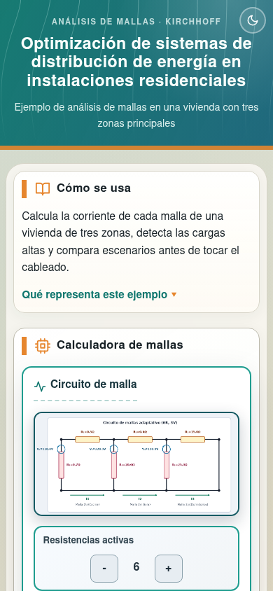

# simulador-circuitos-malla

> Resuelve las corrientes de un circuito de mallas de Kirchhoff y comprueba el resultado, con la
> ley de tensiones verificada malla por malla.

**Demo en vivo**: <https://simulador-circuitos-malla.onrender.com> ·
**[Caso de estudio](docs/CASO-DE-ESTUDIO.md)** · **[Análisis del proyecto](docs/ANALISIS.md)**


---

## Qué hace

Un estudiante de ingeniería recibe ejercicios del tipo *«para el circuito de la figura, obtenga las
corrientes I₁, I₂ e I₃, la potencia en cada resistencia y qué tensión dejaría I₂ en cero»*. Esta
aplicación hace las tres cosas y muestra el procedimiento, no sólo el número.

- **Corrientes de malla** con su sentido, y el circuito dibujado con las corrientes circulando.
- **Potencia en cada resistencia**: las compartidas llevan la diferencia entre las dos mallas que unen.
- **Comprobación de la ley de tensiones** en cada malla, con su residuo.
- **Qué tensión anularía una corriente**, resuelto como análisis inverso.
- **Comprobar el resultado a mano**: se escriben las tres corrientes y la app dice cuáles aciertan.

## Capturas

| Calculadora | Resultados | Móvil |
| --- | --- | --- |
|  |  |  |

---

## Cómo se ejecuta

Todo el servicio es **Rust**. No hay Python en el proyecto.

```bash
cargo run --release --manifest-path rust/Cargo.toml
# escucha en http://0.0.0.0:8000, o en el puerto que indique PORT
```

La plantilla y los estáticos se leen del repositorio: ejecute desde la raíz o indique `APP_ROOT`.

### Con Docker

```bash
docker build -f rust/Dockerfile -t simulador-circuitos-malla .
docker run --publish 8000:8000 --env LOG_FORMAT=json simulador-circuitos-malla
```

La imagen arranca con un único binario, corre como usuario sin privilegios y declara su propia sonda
en `/api/health`.

### Variables de entorno

| Variable | Por defecto | Para qué |
| --- | --- | --- |
| `PORT` | `8000` | Puerto de escucha |
| `APP_ROOT` | `.` | Directorio con `templates/` y `static/` |
| `LOG_LEVEL` | `INFO` | Nivel de registro |
| `RATE_LIMIT_REQUESTS` | `60` | Peticiones POST por cliente y ventana; `0` desactiva el límite |
| `RATE_LIMIT_WINDOW_SECONDS` | `60` | Duración de la ventana del límite |

---

## API

| Método y ruta | Qué devuelve |
| --- | --- |
| `POST /api/calculate` | Corrientes, matriz y vector del sistema, interpretaciones, potencia total, potencia por resistencia, comprobación de tensiones |
| `GET /api/example` | Valores de ejemplo |
| `GET /api/history` | Simulaciones de la sesión (buffer circular de 50) |
| `GET /api/history/{id}` | Una simulación concreta |
| `DELETE /api/history/{id}` | Borra una simulación |
| `DELETE /api/history` | Vacía el historial |
| `POST /api/compare` | Comparación de dos escenarios con deltas absolutos y porcentuales |
| `GET /api/report` | Métricas agregadas del historial |
| `POST /api/export/csv` | Descarga en CSV |
| `POST /api/export/pdf` | Descarga en PDF |
| `GET /api/health` · `/api/version` · `/api/metrics` | Salud, versión y métricas medidas |

Los identificadores de simulación son 16 hex opacos: no se repiten entre reinicios y no son
enumerables.

### Contrato de error

Todas las respuestas de error comparten la forma `success`, `error.code`, `error.message`,
`error.details`. Códigos: `MALFORMED_JSON`, `INVALID_PAYLOAD`, `CALCULATION_ERROR`, `NOT_FOUND`,
`PAYLOAD_TOO_LARGE`, `RATE_LIMITED`, `INTERNAL_ERROR`.

### Límites

- Cuerpo de petición acotado a **64 KB**.
- **60 peticiones POST por minuto y cliente**, con `Retry-After`. El contador vive en el proceso:
  el servicio declara `rate_limit_scope: "process"` porque con varias instancias el techo se
  multiplica. Las lecturas no se limitan.
- El historial vive **en memoria**: se pierde al reiniciar y es compartido por todos los clientes.

## Seguridad

- Cabeceras en todas las respuestas: CSP estricta, `nosniff`, `X-Frame-Options: DENY`,
  `Referrer-Policy: same-origin`.
- Sin `polyfill.io`: el dominio fue comprometido en 2024.
- Validación en el borde del sistema para los nueve campos, con los mismos mensajes en API y
  formulario.

---

## Estructura

```
rust/
├── src/
│   ├── main.rs              # arranque
│   ├── app.rs               # armado: API, interfaz, estáticos y defensas
│   ├── api.rs               # endpoints JSON e historial
│   ├── web.rs               # interfaz con minijinja
│   ├── domain.rs            # parámetros y validación
│   ├── solver.rs            # sistema 3x3 con pivoteo parcial
│   ├── analysis.rs          # interpretaciones, severidad y potencia
│   ├── analisis_estudiante.rs  # potencia por resistencia y comprobación de tensiones
│   ├── objetivo.rs          # qué tensión anula una corriente
│   ├── exporter.rs          # CSV
│   ├── render.rs            # PNG del circuito y PDF
│   ├── seguridad.rs         # cabeceras, límite y métricas
│   └── logging_config.rs    # (integrado en seguridad)
├── tests/                   # 41 pruebas
└── Dockerfile               # imagen de producción
templates/                   # plantilla Jinja servida por minijinja
static/                      # hojas de estilo, scripts e iconos
docs/                        # caso de estudio, análisis y capturas
```

## Verificación

```bash
cargo fmt  --manifest-path rust/Cargo.toml --check
cargo clippy --manifest-path rust/Cargo.toml --all-targets -- -D warnings
cargo test --manifest-path rust/Cargo.toml
```

**41 pruebas**: paridad numérica contra la implementación de referencia, contrato HTTP, exportadores,
análisis inverso, interfaz y defensas (cabeceras, límite y tamaño máximo).

## Despliegue

`render.yaml` describe el servicio: plan gratuito, `rust/Dockerfile`, comprobación de salud en
`/api/health` y auto-despliegue **desactivado**; publicar es un acto deliberado.

En el plan gratuito la instancia se duerme a los quince minutos sin tráfico y tarda cerca de un
minuto en despertar.

## Licencia

MIT.
