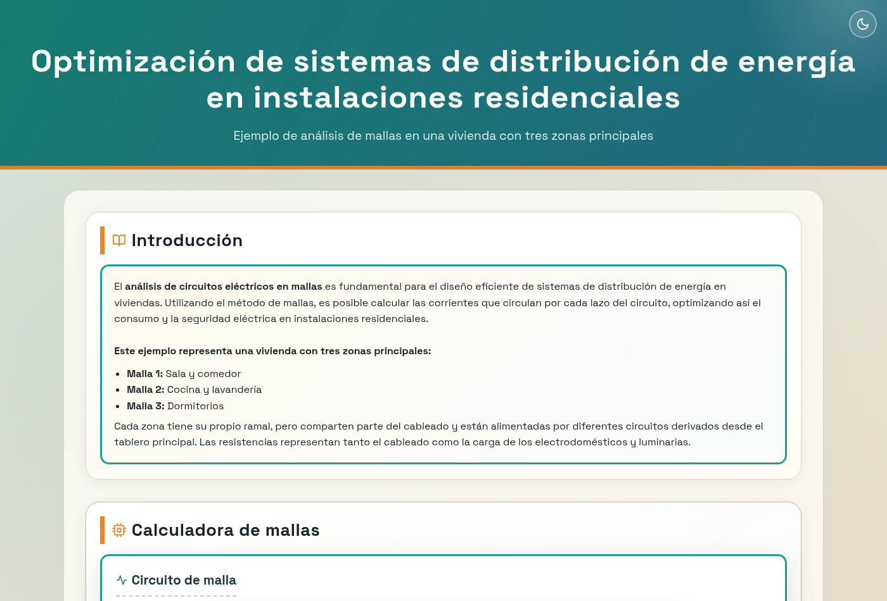
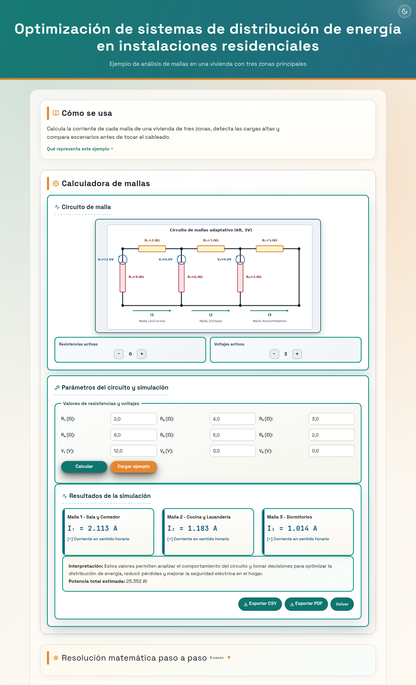

# simulador-circuitos-malla

> Aplicación web para analizar y optimizar la distribución de energía en instalaciones residenciales mediante el **método de análisis de mallas de Kirchhoff** y resolución matricial.
>
> **→ [Caso de estudio](docs/CASO-DE-ESTUDIO.md)**: las decisiones técnicas, la verificación y los defectos que aparecieron al mirar de cerca.


---

## Capturas

| Calculadora | Resultados |
| --- | --- |
|  |  |

---

## Tabla de contenidos

- [Descripción](#descripción)
- [Capturas](#capturas)
- [Caso de estudio](docs/CASO-DE-ESTUDIO.md)
- [Funcionalidades](#funcionalidades)
- [Tech Stack](#tech-stack)
- [Arquitectura del proyecto](#arquitectura-del-proyecto)
- [Instalación y ejecución](#instalación-y-ejecución)
- [Uso de la interfaz](#uso-de-la-interfaz)
- [Referencia de API](#referencia-de-api)
- [Seguridad](#seguridad)
- [Validaciones de entrada](#validaciones-de-entrada)
- [Flujo de desarrollo](#flujo-de-desarrollo)
- [Variables de entorno](#variables-de-entorno)
- [Roadmap](#roadmap)

---

## Descripción

Implementa la simulación web de un circuito residencial de tres mallas (sala/comedor, cocina/lavandería, dormitorios). A partir de valores de resistencias y fuentes de tensión configurables, resuelve el sistema de ecuaciones de Kirchhoff mediante álgebra matricial (NumPy) y genera un diagrama adaptativo del circuito (Matplotlib).

Orientado a estudiantes y académicos de ingeniería eléctrica para analizar la eficiencia y seguridad de la distribución de energía en instalaciones residenciales.

---

## Funcionalidades

- **Cálculo de corrientes de malla** I₁, I₂, I₃ con validación de entradas en servidor y cliente.
- **Diagrama de circuito adaptativo** en PNG según la cantidad de componentes activos (1–6 resistencias, 1–3 fuentes de tensión).
- **Preview en tiempo real** del circuito con debounce de 300 ms al modificar valores.
- **Selector dinámico de componentes** con controles `[+]`/`[-]` directamente en la interfaz.
- **Indicadores de severidad** por magnitud de corriente: baja, normal, alta y crítica.
- **Diseño responsive** para escritorio, tablet y celular (tres breakpoints: 760 px, 520 px, 400 px).
- **Navegación integrada** con botón *Volver* accesible solo en la sección de resultados.
- **Accesibilidad**: soporte de teclado con `:focus-visible` en todos los controles.
- **API JSON** con contrato de error uniforme y endpoints de observabilidad.
- **Modo claro/oscuro** con detección de preferencia del sistema y persistencia en `localStorage`.
- **Notificaciones toast** (info/success/error) y diálogos de confirmación modales.
- **Exportación de resultados** a CSV y PDF (botones en la sección de resultados) con feedback de éxito.
- **Historial de simulaciones** en memoria (buffer circular, 50 entradas) con severidad por corriente, sparkline SVG y botón "Reusar" para cargar parámetros al formulario principal.
- **Comparación de escenarios** (antes/después) con veredicto, flechas de delta y mini-barras.
- **Reporte técnico agregado** con métricas globales y chart de potencia en el tiempo (`<canvas>` con soporte HiDPI).
- **Contador animado** en los valores de I₁, I₂, I₃ al mostrar resultados.
- **Iconos SVG inline** en encabezados de sección y subsección.

---

## Tech Stack

| Capa | Tecnología |
|---|---|
| Backend | Python 3.10+, Flask 3.x |
| Cálculo matricial | NumPy 2.x |
| Renderizado de circuitos | Matplotlib 3.10+ (backend Agg) |
| Generación de PDF | ReportLab 4.x |
| Plantillas | Jinja2 |
| Frontend | HTML5, CSS3, JavaScript (vanilla) |
| Calidad de código | Ruff, Black, pytest |
| CI/CD | GitHub Actions |

---

## Arquitectura del proyecto

```
simulacion_mallas/
├── app.py                        # Entry point
├── pyproject.toml                # Configuración de herramientas (pytest, ruff, black)
├── docs/
│   ├── CASO-DE-ESTUDIO.md        # Decisiones, verificación y defectos encontrados
│   └── capturas/                 # Capturas reales de la aplicación
├── requirements.txt              # Dependencias de ejecución (lo que instala la imagen)
├── requirements-dev.txt          # Añade pytest, ruff, black y pip-audit
├── .github/
│   └── workflows/
│       └── ci.yml                # Pipeline de integración continua
├── Dockerfile                    # Imagen de producción (Gunicorn, usuario sin privilegios)
├── docker-compose.yml            # Arranque local del contenedor
├── wsgi.py                       # Punto de entrada WSGI para Gunicorn
├── gunicorn.conf.py              # Configuración del servidor WSGI
├── healthcheck.py                # Sonda de salud del contenedor
├── src/
│   ├── app_factory.py            # Application factory, handlers de error, métricas
│   ├── config.py                 # Constantes y configuración centralizada
│   ├── logging_config.py         # Registro en texto plano o JSON según el entorno
│   ├── routes/
│   │   ├── api.py                # Endpoints JSON (/api/*)
│   │   └── web.py                # Rutas HTML y renderizado de circuito
│   ├── services/
│   │   ├── mesh_analyzer.py      # Cálculo y análisis de mallas (KVL matricial)
│   │   ├── circuit_renderer.py   # Generación de diagrama PNG
│   │   ├── exporter.py           # Exportación CSV/PDF de simulaciones
│   │   ├── scenario_compare.py   # Comparación de escenarios antes/después
│   │   ├── simulation_store.py   # Buffer circular de historial en memoria
│   │   ├── rate_limit.py         # Límite de peticiones por cliente y ventana
│   │   └── usage_metrics.py      # Métricas en memoria por ruta
│   └── validators/
│       └── inputs.py             # Validación de resistencias y voltajes
├── static/
│   ├── main.js                   # Lógica de interfaz y preview del circuito
│   ├── mathjax-config.js         # Configuración de MathJax sin scripts en línea
│   └── styles.css                # Estilos, tokens de diseño y responsive
├── templates/
│   └── index.html                # Plantilla Jinja2 principal
└── tests/
    ├── test_api.py               # Tests de endpoints API
    ├── test_app_entry.py         # Tests del entry point
    ├── test_error_handlers.py    # Tests de handlers 404/500
    ├── test_logging_config.py    # Tests del registro y del arranque WSGI
    ├── test_mesh_analyzer.py     # Tests del motor de cálculo
    ├── test_phase5.py            # Tests de exportación, historial, comparación y reporte
    ├── test_rate_limit.py        # Tests del límite de peticiones
    ├── test_security.py          # Tests de cabeceras, tamaño máximo y enlace de red
    ├── conftest.py               # Reinicia el límite entre pruebas
    ├── test_validators.py        # Tests de validación de entradas
    └── test_web.py               # Tests de rutas HTML
```

---

## Instalación y ejecución

### Requisitos previos

- Python 3.10 o superior
- PowerShell (Windows) o bash (Linux/macOS)

### Windows (PowerShell)

```powershell
# 1. Clonar el repositorio
git clone https://github.com/runer0101/simulador-circuitos-malla.git
cd simulador-circuitos-malla

# 2. Crear y activar entorno virtual
py -m venv .venv
.\.venv\Scripts\Activate.ps1

# 3. Instalar dependencias (incluye herramientas de desarrollo)
pip install -r requirements-dev.txt

# 4. Ejecutar
python app.py
```

### Linux / macOS

```bash
git clone https://github.com/runer0101/simulador-circuitos-malla.git
cd simulador-circuitos-malla

python3 -m venv .venv
source .venv/bin/activate

pip install -r requirements-dev.txt
python app.py
```

Abrir en el navegador: **http://127.0.0.1:5000**

Para detener el servidor: `Ctrl + C`

### Liberar el puerto 5000 en Windows (si queda ocupado)

```powershell
$conn = Get-NetTCPConnection -LocalPort 5000 -State Listen -ErrorAction SilentlyContinue
if ($conn) { Stop-Process -Id $conn.OwningProcess -Force }
```

---

## Despliegue con Docker

La imagen arranca el servicio con Gunicorn, escucha en el puerto `8000`, corre como usuario sin
privilegios y declara su propio `HEALTHCHECK` contra `/api/health`.

```bash
# Construir y levantar
docker compose up --build

# O sin Compose
docker build -t simulador-circuitos-malla .
docker run --publish 8000:8000 --env LOG_FORMAT=json simulador-circuitos-malla
```

Abrir en el navegador: **http://127.0.0.1:8000**

### Variables de entorno

| Variable | Por defecto | Para qué |
| --- | --- | --- |
| `PORT` | `8000` | Puerto donde escucha Gunicorn y donde sondea el healthcheck |
| `WEB_CONCURRENCY` | `2` | Número de procesos de Gunicorn |
| `WEB_TIMEOUT` | `60` | Segundos antes de que Gunicorn reinicie un worker |
| `LOG_LEVEL` | `INFO` | Nivel de registro |
| `LOG_FORMAT` | `json` en la imagen | `json` emite una línea JSON por evento; cualquier otro valor, texto plano |

Una línea de registro en modo JSON tiene esta forma:

```json
{"time": "2026-11-10T21:40:00-0400", "level": "INFO", "logger": "src.routes.api", "message": "cálculo completado"}
```

`LOG_FORMAT` gobierna los registros **de la aplicación**. Los registros de acceso y de error los emite
Gunicorn con su propio formato de texto, que es el que se ve al arrancar el contenedor.

### Arranque manual con Gunicorn

```bash
gunicorn --config gunicorn.conf.py wsgi:app
```

El pipeline de CI construye la imagen y comprueba el endpoint de salud dentro del contenedor; una
imagen que no levanta rompe la construcción.

---

## Uso de la interfaz

1. Alternar entre **modo claro y oscuro** con el botón en la esquina superior derecha del header (la preferencia se guarda en `localStorage`).
2. Seleccionar la cantidad de resistencias (1–6) y fuentes de tensión (1–3) con los controles `[+]`/`[-]`.
3. Ingresar los valores de cada componente. El preview del circuito se actualiza automáticamente.
4. Hacer clic en **Calcular** para resolver el sistema de mallas.
5. Los resultados muestran las corrientes I₁, I₂ e I₃ con animación de conteo, indicadores de severidad por color y franja lateral según la severidad.
6. Exportar el resultado a **CSV** o **PDF** desde los botones en la barra de acciones (sticky en la sección de resultados).
7. Usar el botón **Volver** (visible solo en la sección de resultados) para regresar a la calculadora.
8. En la sección **Herramientas de análisis avanzado** se puede:
   - **Revisar el historial** de simulaciones con sparkline por entrada. Un clic (o el botón "↺ Reusar") carga los parámetros al formulario principal.
   - **Comparar dos escenarios** (base vs optimizado) con veredicto ↑/↓/→ y mini-barras de delta.
   - **Consultar el reporte técnico** agregado con totales, distribución por severidad y chart de potencia en el tiempo.

---

## Referencia de API

### `GET /api/health`

Healthcheck del servicio.

```json
{ "status": "ok", "service": "simulador-circuitos-malla" }
```

### `GET /api/version`

Versión activa del servicio.

```json
{ "version": "1.0.0" }
```

### `GET /api/metrics`

Métricas básicas de uso en memoria (conteo de llamadas por ruta).

```json
{ "routes": { "/api/calculate": 12, "/": 4 } }
```

### `GET /api/example`

Devuelve valores de ejemplo listos para ingresar en el formulario.

### `POST /api/calculate`

Calcula las corrientes de malla I₁, I₂ e I₃ y registra el resultado en el historial de la sesión.

**Headers:** `Content-Type: application/json`

**Body:**

```json
{
  "R1": 10, "R2": 20, "R3": 15,
  "R4": 30, "R5": 10, "R6": 25,
  "V1": 120, "V2": 60, "V3": 90
}
```

**Respuesta exitosa (`200`):**

```json
{
  "success": true,
  "id": "a69994ebf9c1",
  "currents": {"I1": 2.143, "I2": 1.857, "I3": 0.714},
  "matrix_A": [[...], [...], [...]],
  "vector_B": [...],
  "interpretations": {"I1": "...", "I2": "...", "I3": "..."},
  "power_total": 25.352
}
```

**Contrato de error uniforme:**

```json
{
  "success": false,
  "error": {
    "code": "VALIDATION_ERROR",
    "message": "Valor fuera de rango",
    "details": "R1 debe estar entre 0.01 y 1000 ohm"
  }
}
```

| Código HTTP | Causa |
|---|---|
| `400` | JSON malformado o campos faltantes |
| `400` | Valores fuera de rango |
| `415` | `Content-Type` distinto de `application/json` |

### `POST /api/export/csv` y `POST /api/export/pdf`

Generan un archivo descargable con los resultados de una simulación. Aceptan dos formas de payload:

1. **Por `id` de simulación** (obtenido de `/api/calculate`):

   ```json
   { "id": "a69994ebf9c1" }
   ```

2. **Por parámetros completos** (mismo body que `/api/calculate`).

`/api/export/csv` devuelve `text/csv; charset=utf-8` con la tabla de mallas, potencia total y parámetros. `/api/export/pdf` devuelve un PDF de una página generado con `reportlab`.

| Código HTTP | Causa |
|---|---|
| `200` | Archivo generado |
| `400` | Validación fallida o JSON malformado |
| `404` | `id` no encontrado en el historial |
| `415` | `Content-Type` distinto de `application/json` |

### `GET /api/history`

Lista las simulaciones registradas durante la sesión actual (ordenadas de más reciente a más antigua).

```json
{
  "success": true,
  "count": 2,
  "capacity": 50,
  "items": [
    {
      "id": "...",
      "timestamp": "2026-06-29T13:14:49Z",
      "params": {"R1": ..., "V1": ...},
      "currents": {"I1": ..., "I2": ..., "I3": ...},
      "interpretations": {...},
      "power_total": 25.352
    }
  ]
}
```

### `GET /api/history/<id>`

Devuelve una simulación específica por `id`. Devuelve `404` si no existe.

### `DELETE /api/history`

Limpia el historial completo y devuelve el número de entradas removidas.

### `POST /api/compare`

Compara dos escenarios y devuelve los deltas absolutos y porcentuales de cada malla más la potencia total.

**Body:**

```json
{
  "baseline":  {"R1": 2, "R2": 4, "R3": 3, "R4": 6, "R5": 5, "R6": 2, "V1": 12, "V2": 0, "V3": 0},
  "optimized": {"R1": 1.5, "R2": 3.5, "R3": 2.5, "R4": 5, "R5": 4.5, "R6": 1.8, "V1": 12, "V2": 0, "V3": 0}
}
```

**Respuesta exitosa (`200`):**

```json
{
  "success": true,
  "baseline":  { "currents": {...}, "power_total": 25.35, "max_current": 2.11, ... },
  "optimized": { "currents": {...}, "power_total": 30.93, "max_current": 2.58, ... },
  "comparison": {
    "deltas": {
      "I1":           {"absolute":  0.46, "percent":  22.0},
      "I2":           {"absolute":  0.24, "percent":  20.6},
      "I3":           {"absolute":  0.24, "percent":  23.9},
      "power_total":  {"absolute":  5.58, "percent":  22.0},
      "max_current":  {"absolute":  0.46, "percent":  22.0}
    },
    "power_reduction_label": "empeoramiento",
    "baseline_max_severity": "normal",
    "optimized_max_severity": "normal"
  }
}
```

`power_reduction_label` es uno de `mejora`, `empeoramiento` o `sin cambio`. Si la magnitud base es cero, `percent` se reporta como `null`.

| Código HTTP | Causa |
|---|---|
| `200` | Comparación calculada |
| `400` | Falta `baseline` u `optimized`, o validación fallida |
| `415` | `Content-Type` distinto de `application/json` |

### `GET /api/report`

Devuelve métricas agregadas sobre el historial de la sesión: total de simulaciones, distribución por severidad (baja/normal/alta/crítica), potencia mínima, máxima y promedio, corriente máxima observada y marcas temporales de la primera y última simulación.

```json
{
  "service": "simulador-circuitos-malla",
  "history_capacity": 50,
  "report": {
    "total_simulations": 2,
    "by_severity": {"baja": 0, "normal": 6, "alta": 0, "critica": 0},
    "max_current_observed": 2.58,
    "avg_power_watts": 28.14,
    "min_power_watts": 25.35,
    "max_power_watts": 30.93,
    "first_simulation_at": "2026-06-29T13:14:49Z",
    "last_simulation_at":  "2026-06-29T13:14:49Z"
  }
}
```

---

## Validaciones de entrada

| Componente | Mínimo | Máximo |
|---|---|---|
| Resistencias (R1–R6) | 0.01 Ω | 1 000 Ω |
| Fuentes de tensión (V1–V3) | 0 V | 500 V |

---

## Flujo de desarrollo

```powershell
# Activar entorno
.\.venv\Scripts\Activate.ps1

# Ejecutar tests
python -m pytest -q

# Verificar estilo (lint)
python -m ruff check .

# Verificar formato
python -m black --check .

# Corregir formato automáticamente
python -m black .
```

El pipeline de CI (GitHub Actions) ejecuta los tres pasos en cada `push` y `pull_request`.

---

## Variables de entorno

| Variable | Descripción | Valor por defecto |
|---|---|---|
| `FLASK_DEBUG` | Modo debug de Flask | `false` (seguro en producción) |
| `APP_VERSION` | Versión reportada por `/api/version` | `1.0.0` |

---

## Roadmap

Ver [MEJORAS_POR_FASES.md](MEJORAS_POR_FASES.md) para el plan completo de evolución.

**Próximas mejoras planificadas (Fase 6 — Despliegue y operación):**

- Contenerización con Docker.
- Despliegue en producción con WSGI (Gunicorn) y logs estructurados.

---

> **simulador-circuitos-malla** — Proyecto académico, Universidad Privada Domingo Savio (UPDS), 2026.  
> Tema: *Optimización de sistemas de distribución de energía en instalaciones residenciales.*


## Stack

- Python 3.10+
- Flask 3+
- NumPy 2+
- Matplotlib 3.10+
- HTML/CSS/JavaScript

## Funcionalidades

- Cálculo de corrientes de malla I1, I2, I3 con validación de entradas.
- Render dinámico del circuito en PNG mediante /circuito.png.
- Vista técnica adaptativa del circuito según la cantidad de resistencias y voltajes activos.
- Selector de cantidad de resistencias y voltajes activos desde la interfaz con actualización del preview.
- Vista de resultados integrada con botón Volver visible solo dentro de la sección de resultados.
- Exportación de resultados a CSV y PDF (botones en la sección de resultados).
- Historial de simulaciones en memoria con buffer circular de 50 entradas.
- Comparación de escenarios (antes/después) con deltas absolutos y porcentuales.
- Reporte técnico agregado sobre el historial (potencia, severidad, marcas temporales).
- Diseño responsive para escritorio, tablet y celular.
- Manejo uniforme de errores en API JSON.

## Estructura

- app.py: Entry point de ejecución.
- src/app_factory.py: Creación de aplicación, handlers de error y registro de métricas.
- src/routes/web.py: Rutas HTML y endpoint de imagen de circuito.
- src/routes/api.py: Endpoints JSON de cálculo y operación.
- src/services/mesh_analyzer.py: Cálculo, validación y utilidades de dominio.
- src/services/circuit_renderer.py: Render de circuito PNG.
- src/services/usage_metrics.py: Métricas en memoria por ruta.
- templates/index.html: Vista principal.
- static/main.js: Interacción de formulario y preview del circuito.
- static/styles.css: Estilos y reglas responsive.
- tests/: Pruebas unitarias/funcionales.
- MEJORAS_POR_FASES.md: Roadmap técnico por fases.

## Ejecutar en local (Windows PowerShell)

1. Ir al proyecto:
   cd "c:\Users\ccama\Proyectos\proyectos-web\simulacion_mallas"
2. Crear y activar entorno virtual:
   py -m venv .venv
   .\.venv\Scripts\Activate.ps1
3. Instalar dependencias:
   pip install -r requirements.txt
4. Ejecutar:
   python app.py
5. Abrir:
   http://127.0.0.1:5000

Para apagar el servidor: Ctrl + C en la misma terminal.

Si el puerto 5000 queda ocupado, puedes cerrar el proceso con:

```powershell
$conn = Get-NetTCPConnection -LocalPort 5000 -State Listen -ErrorAction SilentlyContinue
if ($conn) { Stop-Process -Id $conn.OwningProcess -Force }
```

## Flujo diario recomendado

1. Activar entorno virtual:
   .\.venv\Scripts\Activate.ps1
2. Iniciar la app:
   python app.py
3. Trabajar y probar en navegador:
   http://127.0.0.1:5000
4. Validar calidad antes de commit:
   pytest -q
   ruff check .
   black --check .
5. Cerrar servidor:
   Ctrl + C

## Endpoints

### Web

- GET /: Interfaz web principal.
- GET /circuito.png: Diagrama de circuito en PNG con parámetros de query.

Parámetros soportados en /circuito.png:

- R1 a R6
- V1 a V3
- resistance_count: entero entre 1 y 6
- voltage_count: entero entre 1 y 3

### API

- POST /api/calculate: Cálculo por API. Registra la simulación en el historial.
- GET /api/example: Carga de valores de ejemplo.
- GET /api/health: Healthcheck del servicio.
- GET /api/version: Versión activa del servicio.
- GET /api/metrics: Métricas básicas de uso en memoria.
- GET /api/history: Lista de simulaciones registradas en la sesión.
- GET /api/history/<id>: Simulación específica por id.
- DELETE /api/history: Limpia el historial.
- POST /api/export/csv: Genera y descarga CSV de una simulación.
- POST /api/export/pdf: Genera y descarga PDF de una simulación.
- POST /api/compare: Compara dos escenarios y devuelve los deltas.
- GET /api/report: Reporte técnico agregado del historial.

## Contrato de error API

En errores, la API responde en formato uniforme:

- success: false
- error.code
- error.message
- error.details

Casos importantes en /api/calculate:

- 415 Unsupported Media Type cuando no se envía JSON.
- 400 Bad Request cuando el JSON está malformado.
- 413 Payload Too Large cuando el cuerpo supera 64 KB (`PAYLOAD_TOO_LARGE`).
- 429 Too Many Requests cuando se supera el límite de peticiones (`RATE_LIMITED`).

Los restantes códigos son `MALFORMED_JSON`, `INVALID_PAYLOAD`, `CALCULATION_ERROR` e `INTERNAL_ERROR`.

## Límite de peticiones

Los POST de la API —cálculo, exportación y comparación— consumen CPU, así que están limitados por
cliente: **60 peticiones cada 60 segundos** por defecto. Al superarlo la respuesta es `429` con el
contrato de error de arriba y una cabecera `Retry-After` en segundos. Las lecturas (`GET`) no se
limitan y una petición rechazada no deja rastro en el historial.

El contador vive en el proceso. Con varios workers de Gunicorn el techo efectivo se multiplica por
el número de workers; para un tope global compartido haría falta un almacén externo, que este
servicio no necesita.

| Variable | Por defecto | Para qué |
| --- | --- | --- |
| `RATE_LIMIT_REQUESTS` | `60` | Peticiones permitidas por cliente y ventana; `0` desactiva el límite |
| `RATE_LIMIT_WINDOW_SECONDS` | `60` | Duración de la ventana deslizante |

## Seguridad

- **Cabeceras en todas las respuestas**: `Content-Security-Policy` sin scripts en línea (sólo se
  permite el propio origen y jsDelivr para MathJax), `X-Content-Type-Options: nosniff`,
  `X-Frame-Options: DENY` y `Referrer-Policy: same-origin`.
- **Tamaño de petición acotado** a 64 KB, suficiente para los nueve números del formulario.
- **Límite de peticiones** sobre todo lo que consume CPU: los POST de la API, el formulario HTML y
  la generación del PNG del circuito.
- **Sin `polyfill.io`**: el dominio fue comprometido en 2024 y sirvió malware a los sitios que lo
  cargaban. La configuración de MathJax vive en `static/mathjax-config.js` precisamente para que la
  política de seguridad no necesite permitir scripts en línea.
- **Servidor de desarrollo en `127.0.0.1`** por defecto; expone en toda la red sólo si se define
  `HOST`. La imagen de contenedor usa Gunicorn con usuario sin privilegios.
- **Dependencias de ejecución separadas de las de desarrollo**: la imagen no instala `pytest`,
  `ruff` ni `black`. Versiones auditadas con `pip-audit`; `werkzeug` y `pillow` tienen suelo fijado
  en la versión que corrige sus avisos conocidos.

Para comprobarlo usted mismo:

```bash
pip install -r requirements-dev.txt
pip-audit
```

## Rangos de validación

- Resistencias: 0.01 a 1000 ohm.
- Voltajes: 0 a 500 V.

## Calidad

Comandos recomendados antes de publicar cambios:

- pytest -q
- ruff check .
- black --check .

Estado actual validado localmente:

- pytest
- ruff
- black

## Variables de entorno

- FLASK_DEBUG: por defecto seguro en false.
- APP_VERSION: valor reportado por /api/version.
- RATE_LIMIT_REQUESTS: peticiones POST permitidas por cliente y ventana (60 por defecto; 0 desactiva).
- RATE_LIMIT_WINDOW_SECONDS: duración de la ventana del límite (60 por defecto).
- PORT: puerto del servidor; 5000 en desarrollo, 8000 en la imagen.
- LOG_FORMAT: json para registro estructurado; cualquier otro valor, texto plano.
- LOG_LEVEL: nivel de registro (INFO por defecto).

## UX de la interfaz

- El preview del circuito se actualiza en función de los valores ingresados y de la cantidad de componentes activos.
- La navegación desde resultados incluye un botón Volver hacia la calculadora.
- En móviles pequeños se reducen bordes, paddings y tamaños para evitar desbordes horizontales.

## Próximos pasos

Consultar MEJORAS_POR_FASES.md para el plan completo de evolución del proyecto.
